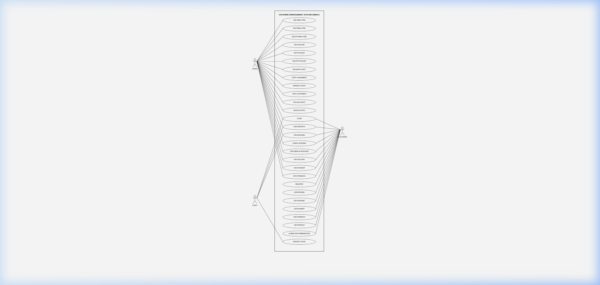
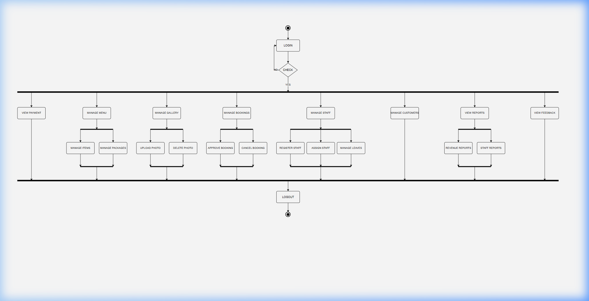
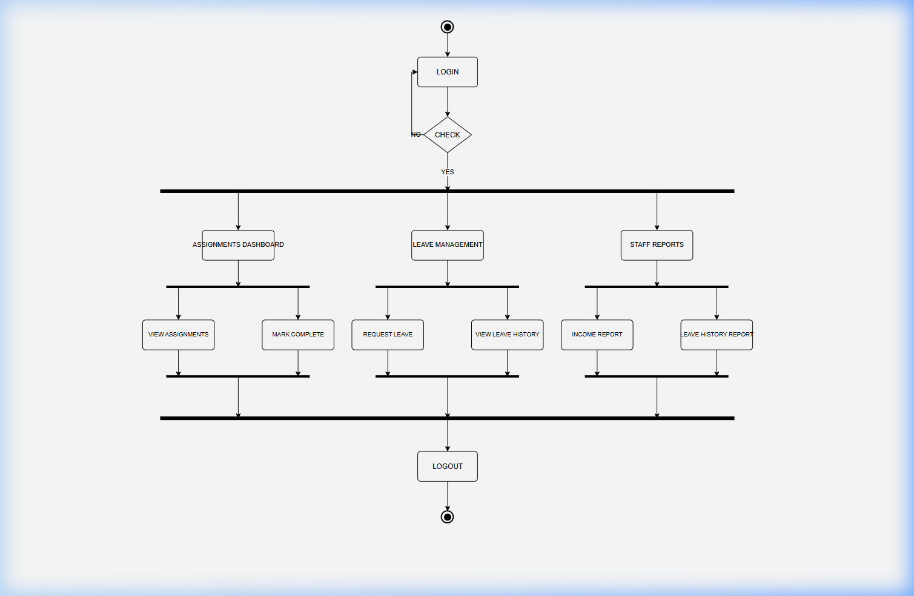
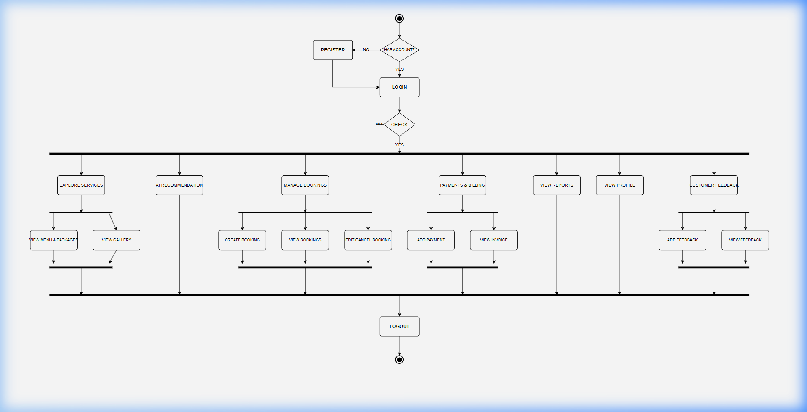
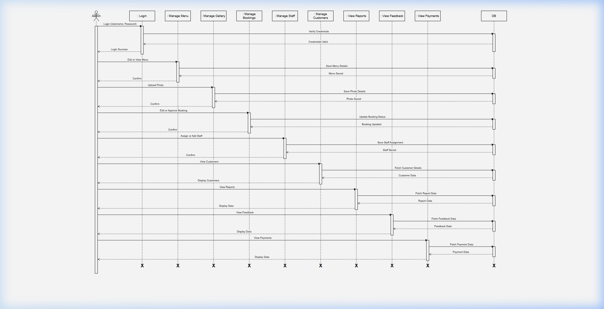
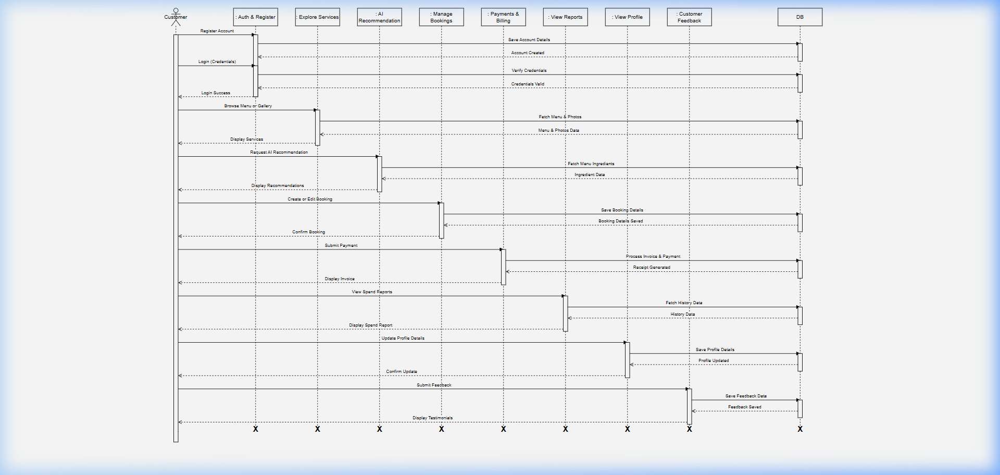
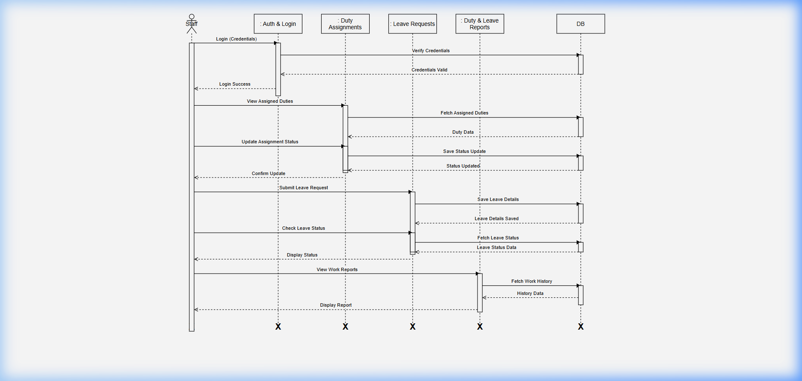
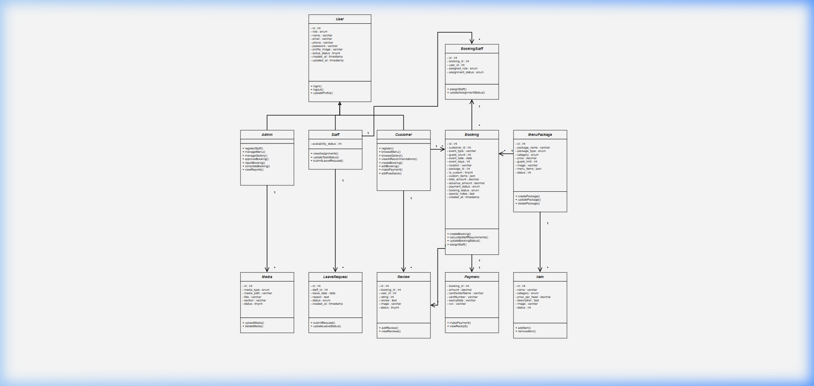

# Swizy Catering Management System - Diagram Portfolio

This guide catalogs the system architecture and UML diagrams for the Swizy Catering Management System.

---

## 1. Use Case Diagram
Maps all customer, admin, and staff use cases inside a unified system boundary.

* **Source File:** [catering_usecase.drawio](catering_usecase.drawio)
* **Image:**

---

## 2. Admin Activity Diagram
Maps administrative workflows including Menu Management, Bookings, Gallery, Payments, Staff Registration, Leaves, and Reporting.

* **Source File:** [admin_activity.drawio](admin_activity.drawio)
* **Image:**

---

## 3. Staff Activity Diagram
Maps staff-side operations: checking assigned duties, updating status, submitting leaves, and viewing reports.

* **Source File:** [staff_activity.drawio](staff_activity.drawio)
* **Image:**

---

## 4. Customer Activity Diagram
Maps customer authentication, exploration, AI recommendations, booking management, payments & billing, and feedback.

* **Source File:** [customer_activity.drawio](customer_activity.drawio)
* **Image:**

---

## 5. Admin Sequence Diagram
Maps administrative execution lifelines, activation blocks, database queries, and response loops.

* **Source File:** [admin_sequence.drawio](admin_sequence.drawio)
* **Image:**

---

## 6. Customer Sequence Diagram
Maps customer execution lifelines, activation blocks, database queries, and response loops.

* **Source File:** [customer_sequence.drawio](customer_sequence.drawio)
* **Image:**

---

## 7. Staff Sequence Diagram
Maps staff execution lifelines, activation blocks, database queries, and response loops.

* **Source File:** [staff_sequence.drawio](staff_sequence.drawio)
* **Image:**

---

## 8. Class Diagram
Maps the static structure of classes in the Swizy Catering System, showing attributes, methods, and relations.

* **Source File:** [class_diagram.drawio](class_diagram.drawio)
* **Image:**

